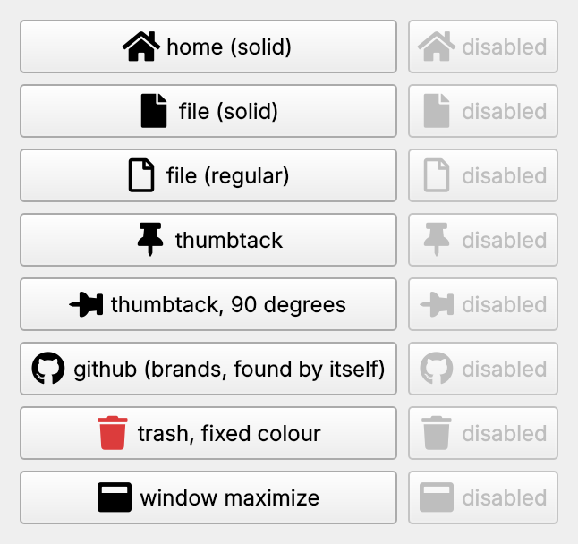

# QFontIcon

QFontIcon is a small Qt class that makes `QIcon`s from an icon font such as [Font Awesome](https://fontawesome.com/). Works with **Qt 6** (and Qt 5). QFontIcon is under the [MIT license](https://opensource.org/licenses/MIT).

- Sharp on high-DPI screens (125 %, 150 %, 200 % ... scaling): icons are drawn at the screen's pixel ratio.
- Drawn in the palette's colours, so they follow light/dark theme changes, and greyed out on disabled widgets. A fixed colour is possible too.
- Rotation, e.g. a pin lying down at 90 degrees.
- **Font Awesome 5**: Solid, Regular and Brands loaded side by side. Solid and Regular share the family name *Font Awesome 5 Free*; QFontIcon keeps them apart by style, and finds a character in whichever loaded font has it.



## Usage

**CMake** (Qt 6 or 5):

```cmake
add_subdirectory(QFontIcon)        # this repository, e.g. as a git submodule or with FetchContent
target_link_libraries(myapp PRIVATE QFontIcon::QFontIcon)
```

**qmake**: copy the `QFontIcon` folder into your project and add to your `.pro`:

```
include("QFontIcon/QFontIcon.pri")
```

Load the fonts once, e.g. in `main()`, after creating the `QApplication`. Put the font files in a resource file (`.qrc`). The first font added is the default:

```cpp
QFontIcon::addFont(":/fonts/fa-solid-900.ttf");     // Font Awesome 5 Free Solid (the default)
QFontIcon::addFont(":/fonts/fa-regular-400.ttf");   // Font Awesome 5 Free Regular
QFontIcon::addFont(":/fonts/fa-brands-400.ttf");    // Font Awesome 5 Brands
```

Then make icons from the characters' codes ([Font Awesome 5 icon list](https://fontawesome.com/v5/search?m=free)):

```cpp
QAction *action = new QAction(QFontIcon::icon(0xf015), tr("Home"));      // or FIcon(0xf015)
pinButton->setIcon(QFontIcon::icon(0xf08d, QColor(), 90.0));             // turned 90 degrees
fileButton->setIcon(QFontIcon::icon(0xf15b, QColor(), 0.0, "Font Awesome 5 Free Regular"));   // outline style
deleteButton->setIcon(QFontIcon::icon(0xf1f8, QColor(220, 60, 60)));    // fixed colour (not advised)
```

`QFontIcon::icon(code, baseColor = QColor(), angle = 0.0, family = QString())`:

| Argument | |
|---|---|
| `code` | The character, as a `QChar` or a number such as `0xf015` |
| `baseColor` | A fixed colour. Invalid (default): the palette's button text colour, which follows theme changes. Disabled icons are greyed out either way |
| `angle` | Rotation in degrees, clockwise |
| `family` | Which font: a family (`"Font Awesome 5 Free"`), or a family and style (`"Font Awesome 5 Free Regular"`). Empty: the first font added. If that font doesn't have the character, the other added fonts are tried in order |

## Example

`main.cpp` shows Font Awesome 5 icons in every style, normal and disabled. Build it with CMake (`cmake -S . -B build && cmake --build build`, then run `build/QFontIconExample`) or open `QFontIcon.pro` in Qt Creator.

## Upgrading from the Qt 5 version

The functions are the same; existing code keeps working. With Qt 6:

- `QFontIcon::icon(0xf015)` with a plain number needs the new `icon(uint, ...)` overload, which is there (Qt 6 can't turn a number into a `QChar` by itself: *"conversion from 'int' to 'const QChar' is ambiguous"*).
- Icons are sharp on high-DPI screens (`QIconEngine::scaledPixmap()`).
- Fixed: a copied icon (Qt copies icons internally, e.g. when a pixmap is added) drew nothing, because `clone()` didn't copy the character.
- Fixed: with Font Awesome 5 Solid and Regular both loaded, icons came from whichever Qt picked for the shared family name, so Solid-only icons could be blank.

## Fonts

`fonts/` holds the Font Awesome 5.15.4 Free fonts (Solid, Regular, Brands), under the SIL OFL 1.1 license; see `fonts/FontAwesome5-LICENSE.txt`. `fontawesome.ttf` is the older Font Awesome 4 font from the original example.
